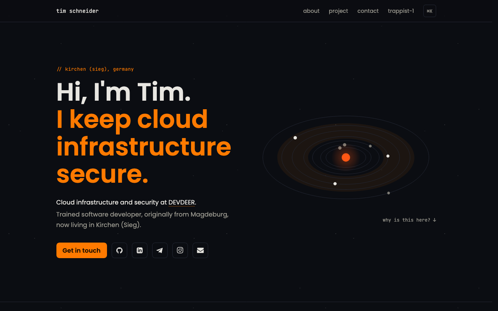

# trappist-1

The source of Tim Schneider's personal website, live at [t-s.dev](https://t-s.dev).



## Why trappist-1?

I love space and everything around it, so I name my projects after exoplanet systems. [TRAPPIST-1](https://en.wikipedia.org/wiki/TRAPPIST-1) is an ultra-cool red dwarf about 40 light-years away, orbited by seven Earth-sized planets, three of them in the habitable zone.

## What's inside

- **Orbit animation**: a canvas rendering of the TRAPPIST-1 system whose planets move with their real orbital period ratios (data: Agol et al. 2021 via the NASA Exoplanet Archive).
- **Planet explorer**: pick any of the seven planets to see its orbital period, radius, distance from the star in AU and whether it sits in the habitable zone.
- **Rallye Timer replica**: a live, animated recreation of my side project [Rallye Timer](https://www.rallyetimer.de/).
- **Command palette**: press <kbd>⌘</kbd> <kbd>K</kbd> or <kbd>Ctrl</kbd> <kbd>K</kbd> to jump to sections, copy the email address, open links or pause the animation.
- **Motion-aware**: respects `prefers-reduced-motion`, has a pause toggle, and stops animating when offscreen or in a background tab.
- **Fully static**: every page is prerendered at build time.

## Tech stack

- [Next.js](https://nextjs.org/) 16 (App Router) with React 19
- TypeScript 6
- [Tailwind CSS](https://tailwindcss.com/) 4 and [daisyUI](https://daisyui.com/) 5
- [Lucide](https://lucide.dev/) icons
- ESLint 9 and Prettier 3
- Node.js 24 and Yarn 4

## Getting started

Prerequisites: Node.js 24 (`nvm use` picks it up from `.nvmrc`) and Corepack (`corepack enable`), which provides the Yarn version pinned in `package.json`.

```bash
yarn install   # install dependencies
yarn dev       # start the dev server on http://localhost:3000
yarn build     # create a production build
yarn start     # serve the production build
yarn lint      # run ESLint
yarn format    # format everything with Prettier
```

## Project structure

```text
app/                 layout, page, robots.txt, sitemap.xml, fonts
components/
  sections/          page sections (hero, about, side project, TRAPPIST-1, contact, ...)
  trappist/          orbit canvas and planet explorer
lib/
  site.ts            content and links: edit this to change the text
  trappist.ts        star and planet data
  motion.ts          shared motion preference (reduced motion + pause toggle)
public/              static assets
docs/REDESIGN.md     design spec
```

## Deployment

The site is deployed on [Vercel](https://vercel.com/).

- Set `NEXT_PUBLIC_SITE_URL` to the public URL; it is used for metadata, `robots.txt` and `sitemap.xml`.
- The Node.js version comes from `engines` in `package.json` (24.x).
- Yarn 4 is provided through Corepack; set the environment variable `ENABLE_EXPERIMENTAL_COREPACK=1` on Vercel.

## Credits

- Planet data: Agol et al. (2021), via the [NASA Exoplanet Archive](https://exoplanetarchive.ipac.caltech.edu/)
- [DSEG7](https://www.keshikan.net/fonts-e.html) font by keshikan, SIL Open Font License 1.1 (see [`app/fonts/DSEG-LICENSE.txt`](app/fonts/DSEG-LICENSE.txt))
- [Lucide](https://lucide.dev/) icons, ISC License
- [Poppins](https://fonts.google.com/specimen/Poppins) and [JetBrains Mono](https://fonts.google.com/specimen/JetBrains+Mono) via Google Fonts, SIL Open Font License
